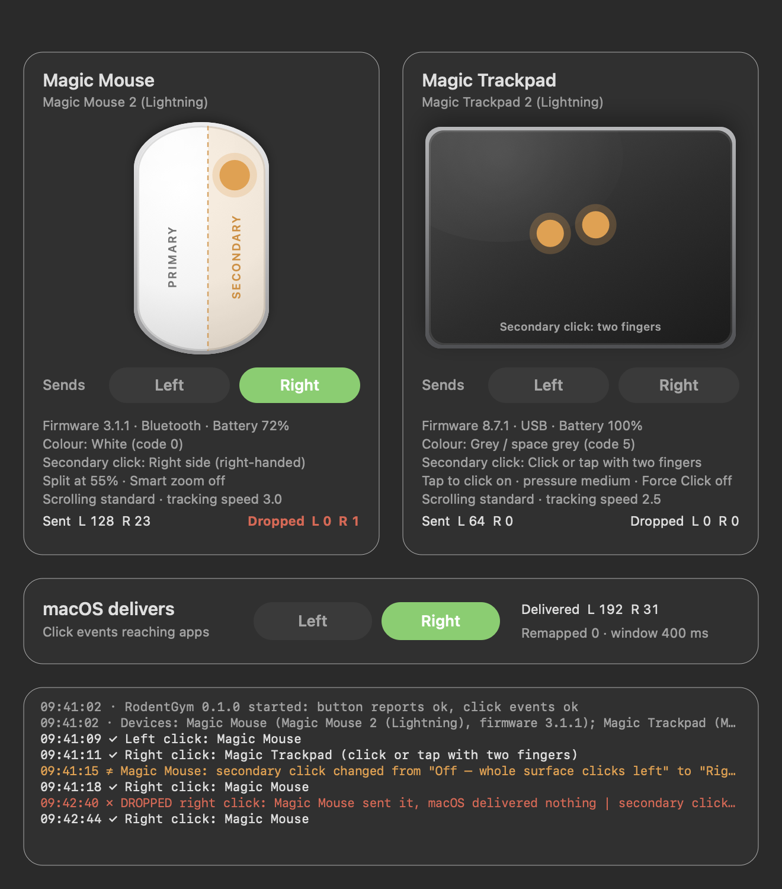
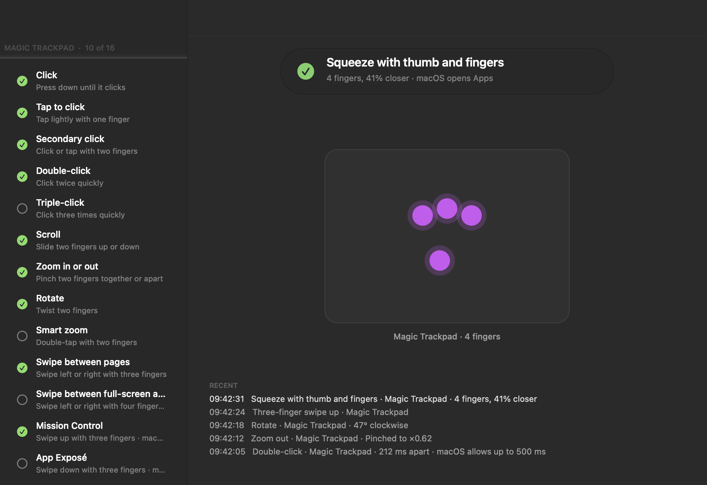
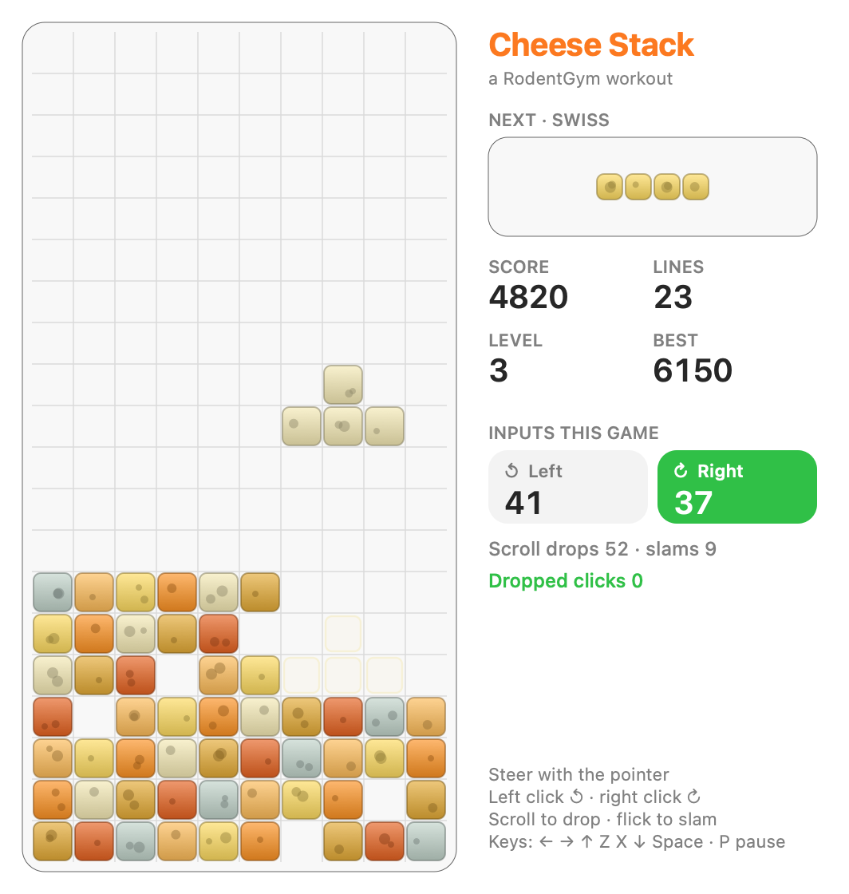

# RodentGym

**See what your Magic Mouse and Magic Trackpad send, and what macOS actually delivers.**

RodentGym is a small native macOS app for diagnosing and exercising pointer input. Right-click doing nothing, clicks going missing, a gesture that seems to have stopped working: RodentGym shows each step between your finger and the app and tells you where things go wrong. It also has two workouts for reproducing intermittent problems: a falling-block game and a gesture trainer.



> **Status: 0.1.0, an early release.** RodentGym reads touch data from a private Apple framework, so treat it as a diagnostic tool rather than something to rely on across macOS updates.

## What it shows

For every connected Magic Mouse and Magic Trackpad (and optionally a MacBook's built-in trackpad):

- **Live touches** on a drawing of the device at the sensor's real proportions, in the device's own colour. Touches that count as a secondary click are highlighted.
- **Secondary-click zones** from your current settings, including the left/right split, left-handed mode and trackpad corner clicks.
- **What the hardware sends**: the raw HID button reports, before macOS processes them.
- **What macOS delivers**: the click events that actually reach apps.
- **Device details**: model, firmware, connection, battery, colour, and the settings the driver is applying right now (not just what System Settings shows).

When the hardware reports a click and macOS never delivers it, RodentGym flags it as **dropped**: a glass alert appears, a sound plays, and the log records the memory state at that moment. Clicks that arrive as the wrong button are flagged as **remapped**. Changes to secondary-click settings are logged as they happen. Live memory status is shown in the window's subtitle.

Everything goes to `~/Library/Logs/RodentGym.log`, so you can line up intermittent problems with whatever else the Mac was doing at the time.

## Gesture Trainer

Open it with **Gym › Gesture Trainer** (⌘T) or the toolbar.



The sidebar is a checklist built from the gestures **you have switched on**, read from each device's driver, the Dock's gesture switches and your global settings. Do a gesture and it gets ticked off. A banner names what was recognised, with details such as the double-click interval against your system limit, how far you pinched, or how many degrees you rotated.

- **App gestures** are captured on the practice pad: click, tap to click, secondary click, double- and triple-click, Force Click, scroll, pinch to zoom, rotate, smart zoom, swipe between pages and three-finger drag.
- **System gestures** are recognised from the raw touch data: Mission Control, App Exposé, swipes between full-screen apps, squeeze (Apps), spread (show desktop), Notification Centre and three-finger tap. macOS still acts on them, because RodentGym never intercepts input. The result is waiting in the checklist and history when you come back.
- Gestures that are switched off show as off. If you perform one anyway, the banner tells you macOS will ignore it.

## Cheese Stack

Open it with **Gym › Cheese Stack** (⌘G) or the toolbar.



Intermittent click problems are hard to reproduce on demand, so RodentGym includes a falling-block game that makes you use every input, quickly and often:

- **Steer** with the pointer
- **Left-click** rotates ↺ and **right-click** rotates ↻. Each button lights up as it arrives, so a missing click is obvious.
- **Scroll** to drop the piece, and **flick** quickly (or middle-click) to slam it down
- Keyboard works too: ← → ↑ Z X ↓ Space, P to pause

The side panel counts every click and scroll, and shows how many clicks RodentGym caught being dropped while you played. If secondary click is switched off on your mouse, the game tells you.

## Design

RodentGym is a native AppKit app that follows Apple's current macOS design guidance:

- **Liquid Glass** (macOS 26 and later) on the control layer only, as Apple recommends: the unified toolbar, the trainer's sidebar, the dropped-click alert, the trainer's banner and the game's overlays. Content stays on standard backgrounds. Older systems fall back to visual-effect materials.
- **Light and dark mode**, Increase Contrast and Reduce Transparency, using semantic system colours throughout. Animations respect Reduce Motion.
- **SF Symbols** in the toolbar and menus, standard menu structure and shortcuts, and a standard settings form.
- **Accessibility**: the custom views expose their content to VoiceOver, and recognised gestures and dropped clicks are announced.
- **Hardened runtime** signing, secure state restoration, and no network access.

## Requirements

- macOS 14 Sonoma or later. Liquid Glass needs macOS 26 or later; RodentGym is developed on macOS 27.
- Xcode Command Line Tools (`xcode-select --install`)

## Build and run

```sh
git clone https://github.com/gofastercloud/RodentGym.git
cd RodentGym
./build.sh            # builds ./build/RodentGym.app and installs it to ~/Applications
open ~/Applications/RodentGym.app
```

Other options:

```sh
./build.sh --no-install   # build only
./build.sh --screenshot   # rebuild the images in docs/ with anonymised demo data

# Open straight into the Gym
open ~/Applications/RodentGym.app --args --show-trainer --show-game
```

There's no Xcode project: the app is a few Objective-C files built with `clang`, ad-hoc signed with the hardened runtime for local use.

## How it works

| Layer | Source | What it tells you |
|---|---|---|
| Touches | `MultitouchSupport.framework` (private) | Where fingers are, per device |
| Button reports | `IOHIDManager` | What the hardware says was pressed |
| Click events | Listen-only `CGEventTap` on the login session | What macOS delivered to apps |
| Device details | IORegistry (`MultitouchPreferences`, `VersionNumber`, `BatteryPercent`, `ColorID`) | Model, firmware, battery, colour, effective settings |
| Gesture settings | Driver preferences, `com.apple.dock`, global defaults | Which gestures are on, and with how many fingers |

A button report is matched against the click event that follows it within a configurable window (400 ms by default). Hot-plugging is handled through IOKit notifications.

## Reading the results

| Log symbol | Meaning | What to do |
|---|---|---|
| ✓ | Click delivered normally | Nothing |
| ≠ | Delivered as a different button, or a setting changed | Check finger placement, or what changed the setting |
| ✗ DROPPED | Hardware reported it, macOS never delivered it | Look at the memory figures on the line; quit heavy apps; restart; report to Apple if it continues |

If a Magic Mouse card says **Secondary click: Off**, the mouse is in one-button mode. Use the Mouse Settings toolbar button to turn on *Secondary click › Click Right Side*. Apple's default for this setting is off, so resetting the mouse preference files switches right-click off.

## Privacy

RodentGym only listens. It never blocks, changes or generates input, and it needs no Accessibility permission. It watches mouse buttons and touches only, never the keyboard. Nothing leaves your Mac, and the log is readable only by you.

Watching mouse click events doesn't normally need a permission prompt. If click events show as unavailable, allow RodentGym under **System Settings › Privacy & Security › Input Monitoring**.

## Limitations

- Touch data comes from Apple's **private** MultitouchSupport framework, which isn't a supported API and could change in any macOS update. It also rules out the Mac App Store.
- Colour comes from the `ColorID` each accessory reports. Apple doesn't document it, but the values match the colour table in Apple's Continuity proximity-pairing messages ([furiousMAC/continuity](https://github.com/furiousMAC/continuity)): 0 White, 1 Black, 2 Red, 3 Blue, 4 Pink, 5 Grey, 6 Silver, 7 Gold, 8 Rose Gold, 9 Space Grey, 10 Dark Blue, 11 Light Blue, 12 Yellow. This has been confirmed on a white Magic Mouse 2 (0), a space grey Magic Trackpad 2 (5) and a space grey MacBook's built-in trackpad (9). If a device is drawn in the wrong finish, override it in Settings, and please open an issue with the model and code.
- System gestures are recognised with simple thresholds on raw touches. Unusual technique can be misread. The trackpad corner area for secondary clicks is drawn approximately.
- Model names are known for the Lightning-era Magic Mouse 2 and Magic Trackpad 2 and the first generation. Other models show their product ID.
- The app icon is a classic `.icns` file. A layered Icon Composer icon needs Xcode.

## Licence

MIT. See [LICENSE](LICENSE).

RodentGym isn't affiliated with or endorsed by Apple. Magic Mouse, Magic Trackpad and Liquid Glass are trademarks of Apple Inc.
