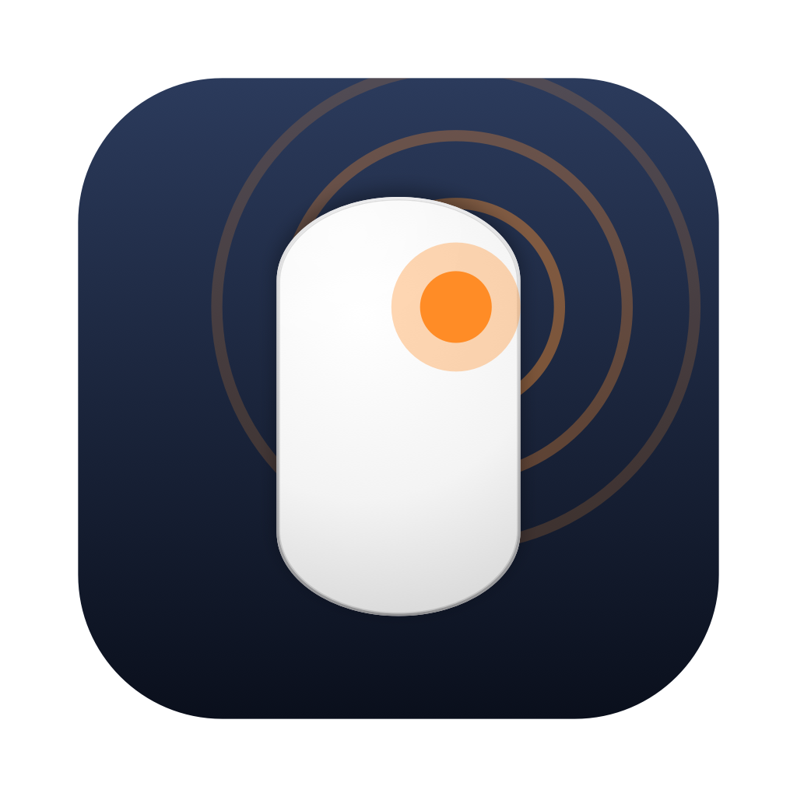
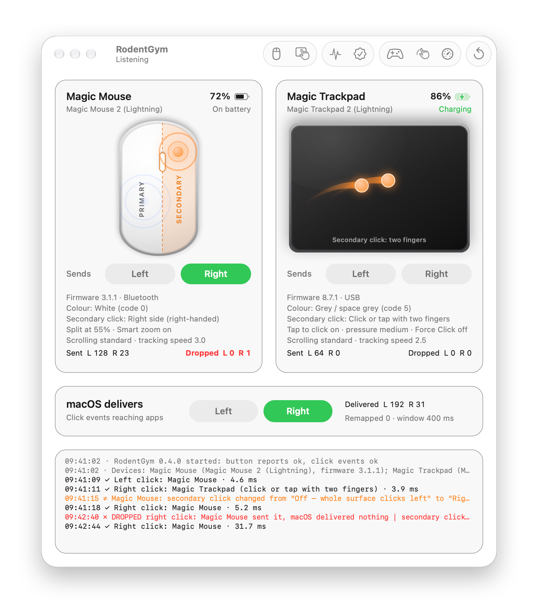
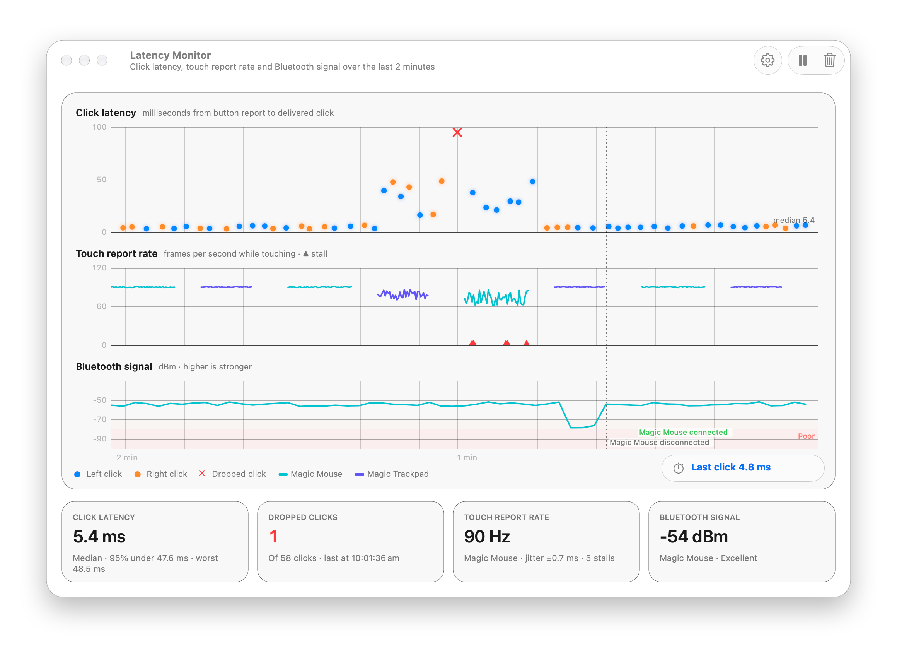
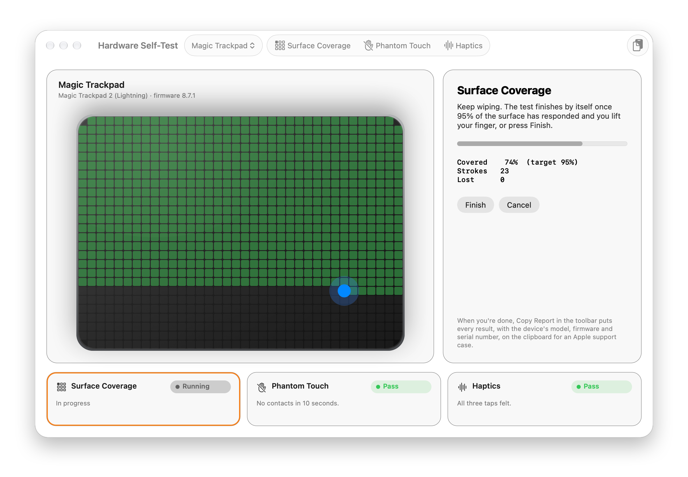
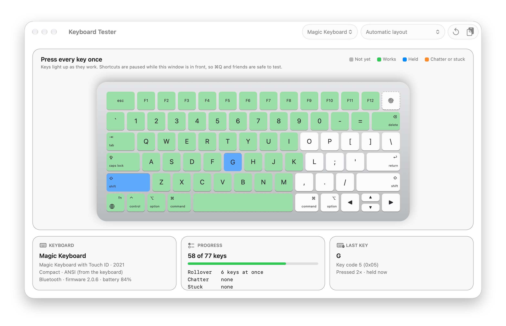
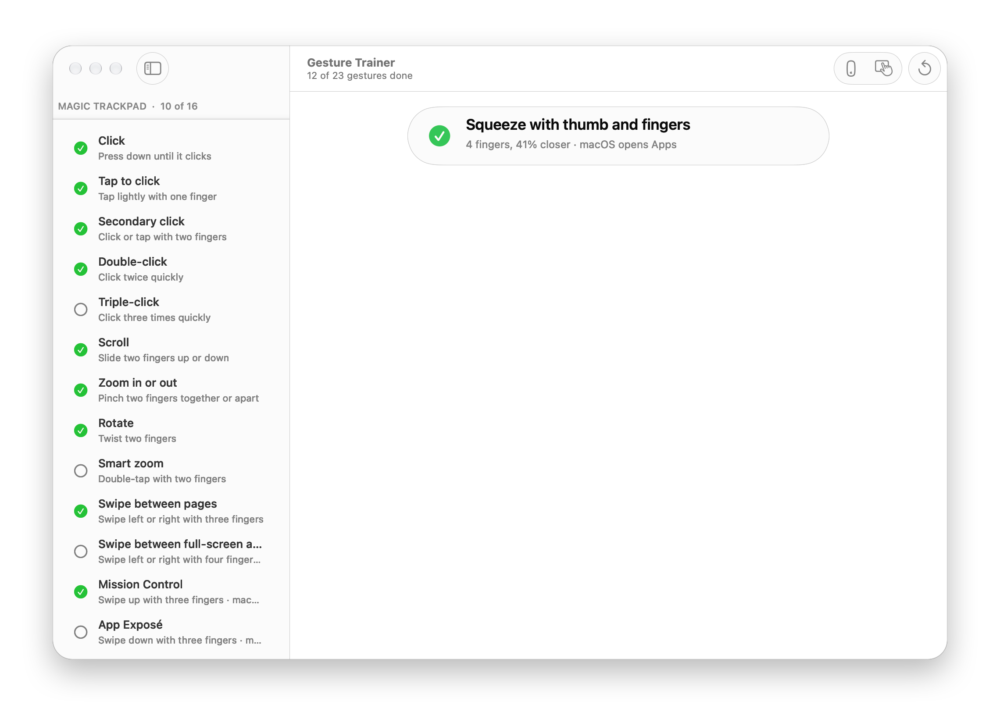
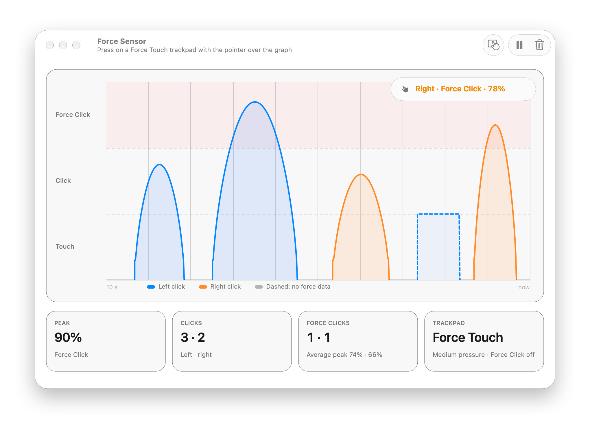
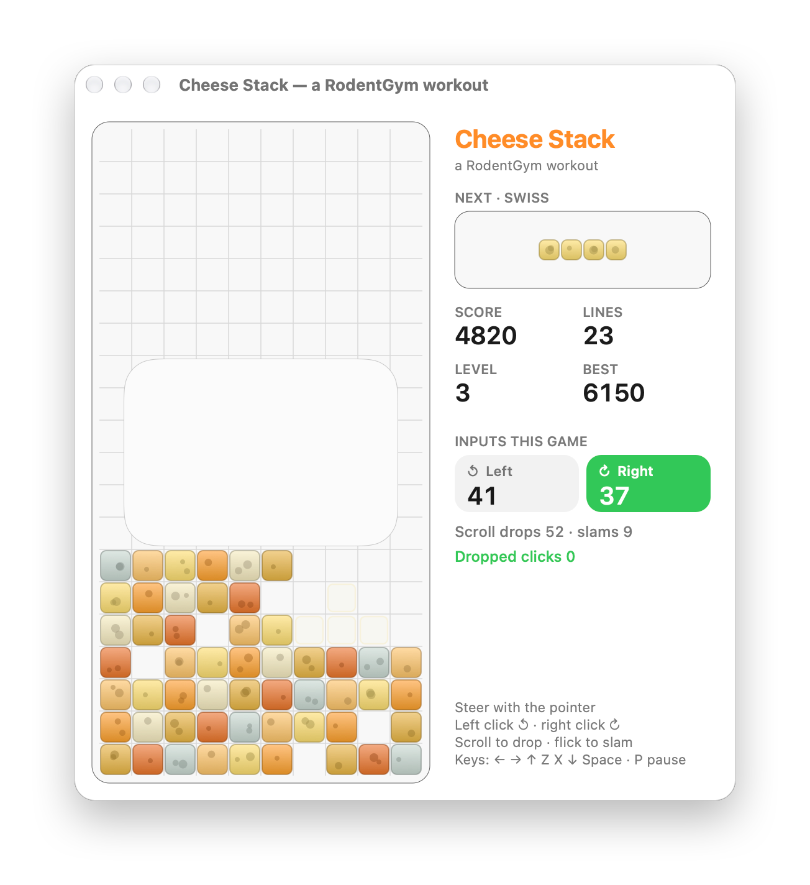
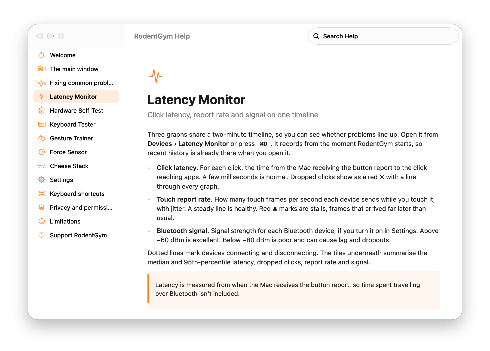

<p align="center">
  
</p>

<h1 align="center">RodentGym</h1>

<p align="center">
  <b>See what your Magic Mouse and Magic Trackpad send, and what your Mac actually does with it.</b><br>
  A small, free, open-source diagnostic app for macOS.
</p>

<p align="center">
  <a href="https://gofastercloud.github.io/RodentGym/">Website</a> ·
  <a href="#get-rodentgym">Get it</a> ·
  <a href="Resources/Help.md">Help</a> ·
  <a href="https://github.com/gofastercloud/RodentGym/discussions">Discussions</a> ·
  <a href="https://github.com/sponsors/gofastercloud">Sponsor</a>
</p>

<p align="center">
  <picture>
    <source media="(prefers-color-scheme: dark)" srcset="docs/images/main-dark.png">
    
  </picture>
</p>

Right-click that does nothing. Clicks that vanish now and then. A trackpad that feels a bit off. These problems are maddening because you can't see where they happen.

RodentGym shows you every step: where your fingers are, what the device reports, and what macOS delivers to your apps. When those don't match, it tells you, logs it, and helps you work out whether the problem is the mouse, the wireless link or the Mac.

It started as a way to find out why one Magic Mouse's right-click kept disappearing. The answer turned out to be a setting that resets itself, and the app kept growing from there.

## What it does

**Live touches and clicks.** Each device is drawn at its sensor's real proportions, in its own colour, with your fingers on it in real time. Trails follow each finger and every click ripples out from where it happened. The secondary-click area is shaded from your actual settings.

**Dropped and remapped clicks.** RodentGym compares the button reports from the hardware with the clicks macOS delivers. A click that never arrives is flagged as **dropped**; one that arrives as the wrong button is flagged as **remapped**. Both are logged with a timestamp.

**The settings that are really in effect.** Model, firmware, colour, battery and charging, and the settings each device's driver is applying right now, which aren't always what System Settings shows. Magic Keyboards get a tile too, with battery and charging status.

**An adjustable Magic Mouse split.** Drag the line between the left and right click areas. System Settings doesn't offer this; it's fixed at 55% unless you change it.

### Latency Monitor

<picture>
  <source media="(prefers-color-scheme: dark)" srcset="docs/images/latency-monitor-dark.png">
  
</picture>

Click latency, touch report rate and Bluetooth signal on one two-minute timeline, with dropped clicks and connects and disconnects marked across all three. When a problem shows up, you can see what else was happening at that moment. Bluetooth signal is opt-in: RodentGym only asks for Bluetooth permission if you turn it on.

### Hardware Self-Test

<picture>
  <source media="(prefers-color-scheme: dark)" srcset="docs/images/self-test-dark.png">
  
</picture>

Three short checks for faults in the device itself: **surface coverage** finds dead zones, **phantom touch** catches a sensor reporting contact when nobody is touching it, and **haptics** checks a Force Touch trackpad's haptic engine. Copy Report gives you a plain-text summary for a support case.

### Keyboard Tester

<picture>
  <source media="(prefers-color-scheme: dark)" srcset="docs/images/keyboard-tester-dark.png">
  
</picture>

Press every key once and watch it light up. The tester also catches what a worn keyboard does: keys that **chatter** (one press arriving as two), keys that **stick**, and how many keys it can report at once. Every Magic Keyboard since 2015, the aluminium Apple Wireless Keyboard and MacBook keyboards are drawn to scale, in ANSI, ISO or JIS, with labels from your own input source. It reads keys only from its own window, so it needs no permission.

### The gym

<table>
  <tr>
    <td width="50%" valign="top">
      <picture>
        <source media="(prefers-color-scheme: dark)" srcset="docs/images/gesture-trainer-dark.png">
        
      </picture>
      <b>Gesture Trainer.</b> A checklist of the gestures you have switched on. Do each one and it's ticked off, including system gestures like Mission Control.
    </td>
    <td width="50%" valign="top">
      <picture>
        <source media="(prefers-color-scheme: dark)" srcset="docs/images/force-sensor-dark.png">
        
      </picture>
      <b>Force Sensor.</b> A live graph of how hard you press on a Force Touch trackpad, through click and Force Click.
    </td>
  </tr>
  <tr>
    <td width="50%" valign="top">
      <picture>
        <source media="(prefers-color-scheme: dark)" srcset="docs/images/cheese-stack-dark.png">
        
      </picture>
      <b>Cheese Stack.</b> A falling-block game that uses every input, so intermittent problems show up while you play.
    </td>
    <td width="50%" valign="top">
      <picture>
        <source media="(prefers-color-scheme: dark)" srcset="docs/images/help-dark.png">
        
      </picture>
      <b>Built-in help.</b> Searchable, with a page for each tool and the usual problems and their fixes.
    </td>
  </tr>
</table>

## Get RodentGym

RodentGym runs on macOS 14 Sonoma or later. It's developed on macOS 27 and uses Liquid Glass on macOS 26 and later.

**Signed downloads and Homebrew are coming soon.** Until then, building it yourself takes about a minute and needs only Apple's free command line tools:

```sh
xcode-select --install          # once, if you don't have the command line tools
git clone https://github.com/gofastercloud/RodentGym.git
cd RodentGym
./build.sh                      # builds and installs to ~/Applications
open ~/Applications/RodentGym.app
```

There's no Xcode project: the app is a handful of Objective-C files, built with `clang` and signed for local use.

<details>
<summary>More build options</summary>

```sh
./build.sh --no-install   # build only, into ./build
./build.sh --screenshot   # regenerate the images in docs/images from anonymised demo data

# Open straight into a tool
open ~/Applications/RodentGym.app --args --show-latency --show-selftest --show-trainer --show-game --show-force

# Draw every keyboard layout to PNGs, to check layout data by eye
build/RodentGym.app/Contents/MacOS/RodentGym --keyboard-layouts /tmp/layouts
```
</details>

## Privacy

RodentGym watches mouse buttons and touches. It never opens a keyboard or watches typing in other apps: the Keyboard Tester only sees keys pressed in its own window, and doesn't log them. It makes no network connections, needs no Accessibility permission, and nothing leaves your Mac. Its log stays in `~/Library/Logs` and only you can read it.

It only listens, with one exception: if you move the Magic Mouse split, it saves your new split to the mouse's preferences.

Watching click events doesn't normally need permission. If click events show as unavailable, allow RodentGym under **System Settings › Privacy & Security › Input Monitoring**. Bluetooth permission is only requested if you turn on signal monitoring. Because a self-built app is signed locally, each rebuild may prompt again.

## How it works

| What | Where it comes from | What it tells you |
|---|---|---|
| Touches, report rate, stalls | `MultitouchSupport.framework` (private), every frame | Where fingers are, and how steadily each device reports |
| Button reports | `IOHIDManager` | What the hardware says was pressed, and when |
| Click events | Listen-only `CGEventTap` on the login session | What macOS delivered to apps |
| Click latency | HID report timestamp vs event arrival | Time from button report to delivered click |
| Device details | IORegistry (`MultitouchPreferences`, `VersionNumber`, `ColorID`) | Model, firmware, colour, effective settings |
| Battery | Accessory power sources (as `pmset -g accps` uses) | Level, charging, on cable or battery |
| Gesture settings | Driver preferences, `com.apple.dock`, global defaults | Which gestures are on |
| Click pressure, haptics | `NSEvent` pressure, `NSHapticFeedbackManager` | Force Click and the haptic engine |
| Bluetooth signal (opt-in) | `IOBluetoothDevice.rawRSSI` | Link quality in dBm |

A button report is matched with the click event that follows it within a configurable window, 400 ms by default. Devices are picked up as they connect and disconnect.

## Limitations

- Touch data comes from Apple's **private** MultitouchSupport framework. A macOS update could change or break it, and it rules out the Mac App Store.
- Latency starts when the Mac receives the button report, so time spent over Bluetooth isn't included.
- Stall and lost-stroke detection are heuristics that haven't yet been checked against known-faulty hardware. Reports from people with genuinely faulty devices are very welcome.
- Colour codes aren't documented by Apple. RodentGym's table matches real devices, and Settings can override it. If yours is wrong, please open an issue with the model and code.
- Mouse and trackpad model names are known for the Magic Mouse 2, Magic Trackpad 2 and first-generation devices, and every Apple keyboard since 2007 by product ID. Other models show their product ID.

## Contributing

Contributions of every size are welcome: a typo, a better explanation in the help, support for a device model, or a whole new tool. [CONTRIBUTING.md](CONTRIBUTING.md) explains how the code fits together and how to get a change in.

Not sure where to start? Have a look at issues labelled [good first issue](https://github.com/gofastercloud/RodentGym/labels/good%20first%20issue), or ask in [Discussions](https://github.com/gofastercloud/RodentGym/discussions). Questions like "is this reading normal?" are welcome there too.

**Testers wanted.** RodentGym has only been tried on a few devices. Ten minutes with yours and a [test report](https://github.com/gofastercloud/RodentGym/issues/new?template=test_report.yml) is one of the most useful things you can do, even if everything works. The [testing checklist](CONTRIBUTING.md#testing) has ideas for what to try.

Found a bug? [Open an issue](https://github.com/gofastercloud/RodentGym/issues/new/choose). [Reporting a problem](CONTRIBUTING.md#reporting-a-problem) has an example of a report that's easy to act on.

## Support

RodentGym is free and will stay that way. If it saved you an afternoon, or a trip to the Apple Store, you can [sponsor its development on GitHub](https://github.com/sponsors/gofastercloud). It's never expected and always appreciated. A star, or telling someone who's fighting their mouse, helps too.

## Licence

MIT. See [LICENSE](LICENSE).

RodentGym isn't affiliated with or endorsed by Apple. Magic Mouse, Magic Trackpad, Magic Keyboard, Force Touch, Touch ID and Liquid Glass are trademarks of Apple Inc.
